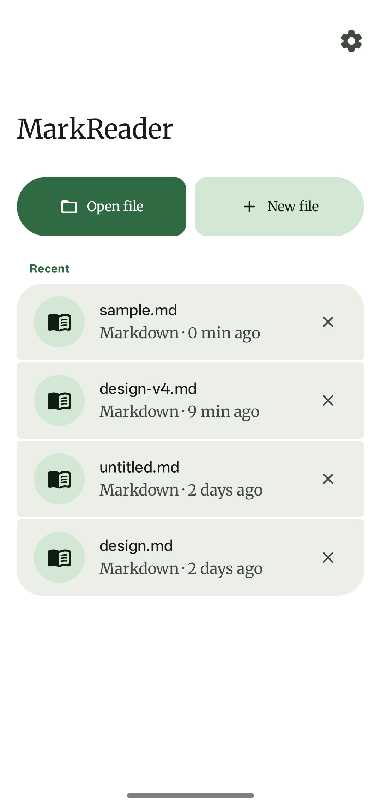
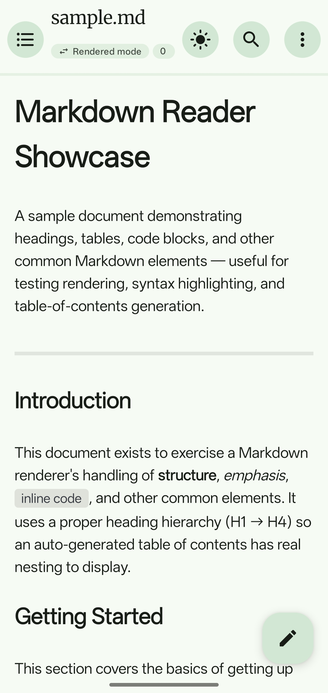
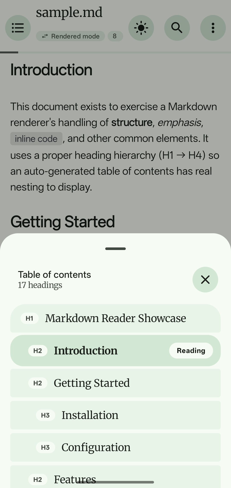
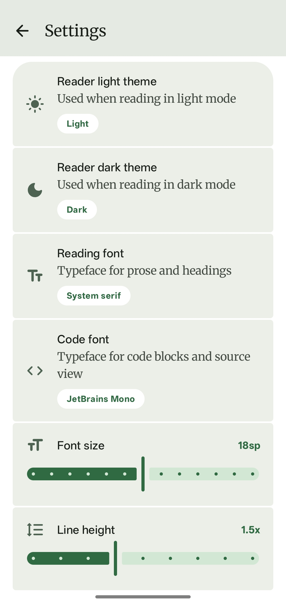
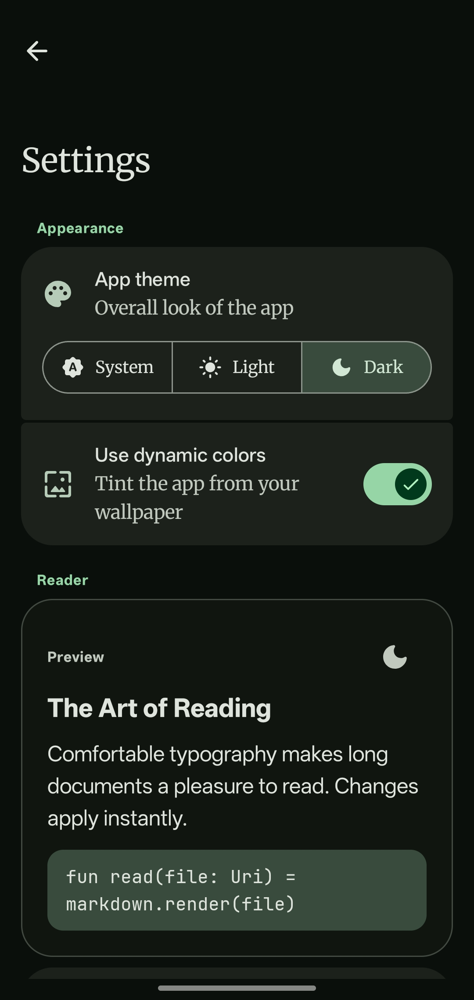
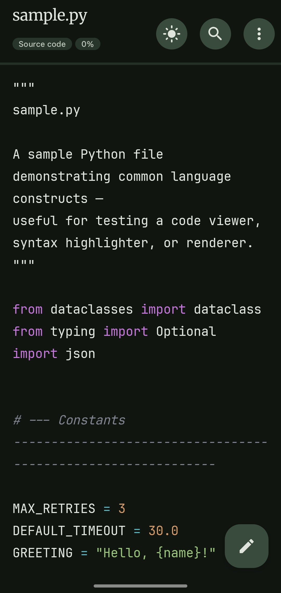

# MarkReader

<p align="center">
  <a href="https://github.com/usamaiqb/mark-reader/actions/workflows/ci.yml"></a>
  <a href="https://github.com/usamaiqb/mark-reader/releases"></a>
  <a href="https://f-droid.org/packages/com.markreader/"></a>
  <a href="https://www.gnu.org/licenses/gpl-3.0"></a>
</p>

Read Markdown and source code on your phone, rendered the way it was meant to look, with a built-in editor for your notes. No ads, no tracking, no accounts, and no internet access.

Also available on [desktop](https://github.com/usamaiqb/markreader-desktop).

<p align="center">
  <a href="https://f-droid.org/packages/com.markreader/"></a>
</p>

Download the latest APK from the [Releases](https://github.com/usamaiqb/mark-reader/releases) page.

> GitHub, F-Droid and Google Play builds are signed with the same key. SHA-256 certificate fingerprint:
> `1E:09:59:11:C0:34:28:52:0E:8B:60:F7:B9:DB:F4:55:BF:38:58:18:51:6D:9C:15:90:49:68:71:C8:3D:5F:89`

## Help test on Google Play

We're working on getting MarkReader published on Google Play. The app is already available there in **closed testing**, and we need real users trying it out to get it fully published.

1. Join the [Google Group](https://groups.google.com/g/mr-testers) (approval may take a few minutes)
2. Once approved, [opt in as a tester](https://play.google.com/apps/testing/com.markreader)
3. Install the app from Google Play and open it a few times over the next two weeks

<p align="center">
  <a href="https://play.google.com/apps/testing/com.markreader"></a>
</p>

Thank you! This helps us reach far more users than F-Droid and GitHub alone.

## Screenshots

<p align="center">
  
  
  
  
  
  
</p>

## Features

### Reading

- **Markdown rendering** - Headings, emphasis, blockquotes, lists, tables and fenced code blocks
- **Syntax highlighting** - Source files highlighted for dozens of languages, including Kotlin, Python, JavaScript, Java, C/C++, HTML, CSS, JSON and YAML
- **Rendered or raw** - Switch any Markdown file between its rendered view and its source
- **Search and outline** - Find text in a document and jump between headings from the table of contents
- **Export and share** - Export a document as PDF or HTML, or share its source

### Editing

- **Built-in editor** - Write notes and edit Markdown with a live preview tab
- **Formatting toolbar** - Bold, italic, strikethrough, code, links, lists and quotes while you type
- **Save and Save As** - Save in place, or save a copy to a new location
- **New files** - Start a note or a file from scratch

### App

- **Open from anywhere** - Open files from any file manager through the standard open and share actions
- **Reader themes** - Light, dark, AMOLED and sepia, with your choice of reading font, code font, size, line height and alignment
- **Material You** - Material 3 with dynamic color, plus Light, Dark and System themes
- **Fully private** - Files are read on your device and never leave it

## Requirements

- Android 7.0 (Nougat) or higher

<details>
<summary><h2>Permissions</h2></summary>

MarkReader requests no permissions. Files are opened through Android's standard content URI system, so no storage permission is needed.

MarkReader has no internet permission.

</details>

## Building

Requires JDK 17 and the Android SDK (API 36).

```bash
git clone https://github.com/usamaiqb/mark-reader.git
cd mark-reader
./gradlew assembleDebug
```

The APK is written to `app/build/outputs/apk/debug/`. See [CHANGELOG.md](CHANGELOG.md) for version history.

## Contributing

Contributions are welcome. Use [Issues](https://github.com/usamaiqb/mark-reader/issues) for bugs and questions.

## Credits

- [Markwon](https://github.com/noties/Markwon) - Markdown rendering
- [Prism4j](https://github.com/noties/Prism4j) - Syntax highlighting
- [Merriweather](https://github.com/SorkinType/Merriweather), [Merriweather Sans](https://github.com/SorkinType/Merriweather-Sans) and [JetBrains Mono](https://github.com/JetBrains/JetBrainsMono) - Bundled fonts

License notices are in [licenses/THIRD_PARTY_LICENSES.md](licenses/THIRD_PARTY_LICENSES.md).

## License

[GNU General Public License v3.0](LICENSE). See the [Privacy Policy](PRIVACY_POLICY.md) for how the app handles data.
